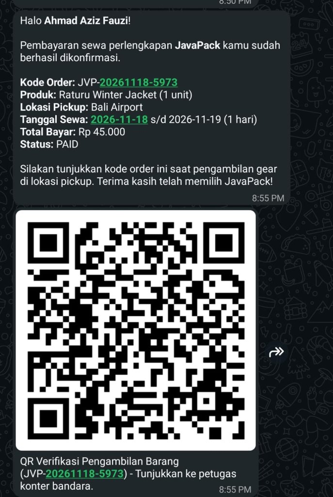
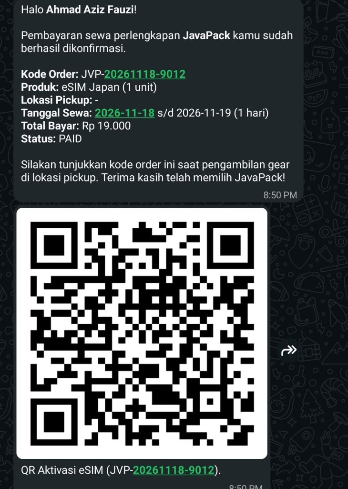

# JavaPack

An international travel gear rental platform featuring a **Public Website**, **Admin CMS**, **Midtrans Sandbox** payment integration, and **n8n** workflow automation.

## Repository Structure

This repository consists of two main applications:

- **[`frontend/`](./frontend/README.md)** — Web application built with **Next.js & Tailwind CSS** covering the Public Website (Home, About Us, Product Catalog, FAQ, Contact, Auth, Profile & Rental History) and the Admin CMS Panel. See [Frontend Documentation](./frontend/README.md) for detailed setup, module structure, and design tokens.
- **[`backend/`](./backend/README.md)** — REST API built with **Express.js & MySQL (Sequelize ORM)** handling JWT authentication, CMS content management, products & categories, pickup locations, rental orders, and Midtrans & n8n webhooks. See [Backend Documentation](./backend/README.md) for detailed API endpoints, database migrations, and seeders.

## n8n Automation & WhatsApp Notification

Once a payment is confirmed (`PAID`), JavaPack automatically triggers an **n8n + WAHA** workflow that sends an order confirmation message and a **QR code** directly to the customer's WhatsApp.

- **Ready to Test Out of the Box:** `backend/.env.example` already points to our live n8n webhook (`http://195.88.211.211:5678/webhook/javapack-order`). Just register using an active WhatsApp number and complete a checkout — notifications and QR images work immediately from localhost without setting up n8n yourself.
- **Workflow File:** [`backend/n8n-javapack-workflow.json`](./backend/n8n-javapack-workflow.json)

## Physical vs Digital Products & QR Verification

- **Physical Gear (e.g., Jacket, Pocket WiFi, Luggage):** Customers choose an airport pickup counter during checkout. The WhatsApp QR opens a quick verification page for counter staff (login: `petugas@gmail.com` / `password`) with a simple toggle to activate the rental (`active_rent`).
- **Digital Products (e.g., `eSIM Japan`):** No airport pickup counter is needed during checkout, and the WhatsApp QR delivers the eSIM activation code directly.
- **Testing `localhost` QR on an Android Phone:** Connect your Android phone via USB (with USB Debugging on) and run:

  ```bash
  adb reverse tcp:3000 tcp:3000
  adb reverse tcp:5000 tcp:5000
  ```

  Now scanning the QR from your phone will open your laptop's `localhost` page directly without changing any `.env` settings.

### Sample WhatsApp Output

| Physical Gear (Airport Pickup QR) | Digital Product (eSIM Activation QR) |
| :---: | :---: |
|  |  |
